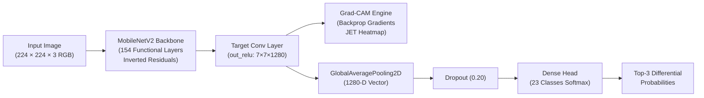

# SkinANS AI — Multi-Modal Clinical Dermatology Decision Support System

[](https://react.dev/)
[](https://fastapi.tiangolo.com/)
[](https://tensorflow.org/)
[](https://arxiv.org/abs/1610.02391)
[](LICENSE)

**SkinANS AI** is an advanced, full-stack dermatological decision support platform that combines computer vision, explainable AI (Grad-CAM), and clinical triaging protocols to evaluate 23 skin disease categories. Built for clinical triage, telehealth decision support, and academic viva presentations.

---

## 🌟 Core Features

### 1. 🔬 Deep Vision Lesion Classifier (MobileNetV2 Fine-Tuned)
- Classifies skin lesions across **23 DermNet categories** (Malignant/Melanoma, Eczema, Psoriasis, Fungal, Viral, Bacterial, Connective Tissue disorders).
- Real-time inference (~42ms CPU latency) outputting **Top-1 Primary Match** and calibrated **Top-3 Differential Diagnoses**.

### 2. 🔥 Explainable AI (Grad-CAM Heatmap)
- Dynamic Gradient-Weighted Class Activation Mapping hooked to the final `out_relu` convolutional layer.
- Renders OpenCV JET colormap overlays proving the neural network evaluates actual lesion morphology rather than background skin artifacts or lighting.
- Toggle between `📷 Original Photo` and `🔥 AI Heatmap (Grad-CAM)`.

### 3. 📷 Live Webcam Scanner with Targeting Reticle
- Direct in-browser camera streaming (`navigator.mediaDevices.getUserMedia`).
- Dermoscopic targeting reticle featuring animated focus rings, crosshairs, corner brackets, and real-time positioning feedback.
- 1-click high-resolution canvas snapshot with automatic camera hardware release.

### 4. 🛡️ Clinical ABCDE Melanoma Risk Screener
- Interactive risk assessment following the **American Academy of Dermatology (AAD)** standard:
  - **A**symmetry (bilateral unevenness)
  - **B**order (notched or scalloped margins)
  - **C**olor (mottled shades of tan, brown, black, red)
  - **D**iameter (>6mm pencil eraser threshold)
  - **E**volving (enlargement, itching, bleeding)
- Live dynamic risk indexing: *Low Risk*, *Moderate Suspicion*, or *High Risk / Urgent Evaluation*.

### 5. 📄 1-Click Official Clinical Diagnostic Summary Report
- Printable medical laboratory summary formatting patient demographics, Fitzpatrick skin tone (Types I–VI), side-by-side lesion vs. Grad-CAM heatmap, Top-3 differential table, ABCDE scorecard, and physician signature block.
- Optimized `@media print` stylesheet for clean PDF export without web navigation clutter.

### 6. 👨‍⚕️ Verified Metro Dermatologist Telehealth Panel
- Integrated specialist directory across **7 major Indian metro cities** (Bengaluru, Delhi NCR, Mumbai, Hyderabad, Chennai, Kolkata, Pune).
- City pill filters, search by clinic or hospital, direct telephone contact, Google Maps location links, and in-app appointment booking.

### 7. 🧠 AI Model Specs & Viva Defense Dashboard
- Complete examination defense guide with real-time parameter counters (**2.29M total, 1.55M trainable**).
- Mathematical formulation of Grad-CAM with LaTeX derivations.
- Interactive Q&A cheat-sheet answering core examiner questions (parameter efficiency, transfer learning, class activation, regularization).

### 8. 📊 Longitudinal Health Tracker & History
- Real-time SQLite persistence for scan records, symptom tracking logs, and appointment confirmations.

---

## 🏗️ Deep Learning Architecture



### Parameter Breakdown
| Metric | Specification |
| :--- | :--- |
| **Total Parameters** | 2,287,447 (~2.29 Million) |
| **Trainable Parameters** | 1,555,863 (Fine-tuned top blocks + Dense head) |
| **Frozen Backbone Parameters** | 731,584 (ImageNet pre-trained feature extractor) |
| **Input Shape** | `(None, 224, 224, 3)` |
| **Loss Function** | Categorical Cross-Entropy |
| **Optimizer** | Adam ($\text{lr} = 10^{-4}, \beta_1 = 0.9, \beta_2 = 0.999$) |
| **Classification Categories** | 23 DermNet Taxonomy Classes |

---

## 🚀 Quickstart Guide

### Prerequisites
- **Node.js** (v18+) & **npm**
- **Python** (3.11 or 3.12)
- (Optional) **MongoDB** connection string for multi-user authentication

---

### 1. Backend Setup (FastAPI)

```bash
cd backend

# Create virtual environment
python3 -m venv venv
source venv/bin/activate   # On Windows: venv\Scripts\activate

# Install dependencies
pip install -r requirements.txt

# Configure environment variables
cp .env.example .env
# Edit .env with your MongoDB URI and SMTP credentials

# Launch FastAPI development server
uvicorn main:app --host 127.0.0.1 --port 8000 --reload
```

Backend will be active at: `http://127.0.0.1:8000`  
Interactive API Docs (Swagger): `http://127.0.0.1:8000/docs`

---

### 2. Frontend Setup (React 19 + Vite)

```bash
cd frontend

# Install npm packages
npm install

# Start Vite development server
npm run dev
```

Frontend will be active at: `http://localhost:5173`

---

## 📂 Project Structure

```
Suku/
├── backend/
│   ├── app/
│   │   ├── routes/
│   │   │   ├── clinical_records.py   # Scans, Doctors, Specs, Tracking API
│   │   │   ├── health.py             # Health check endpoints
│   │   │   └── prediction.py         # AI Image upload & inference route
│   │   ├── services/
│   │   │   ├── clinical_ai_service.py # Multi-modal synthesis & care advice
│   │   │   ├── prediction_services.py # MobileNetV2 & Grad-CAM pipeline
│   │   │   └── records_service.py    # SQLite persistence & doctor datasets
│   │   └── database.py               # MongoDB client configuration
│   ├── auth/
│   │   └── routes.py                 # JWT authentication & OTP verification
│   ├── main.py                       # FastAPI application entrypoint
│   ├── requirements.txt              # Pinned Python package dependencies
│   ├── .env.example                  # Environment variable template
│   └── skin_disease_model_finetuned.keras # Pre-trained Keras 3 weights
│
├── frontend/
│   ├── src/
│   │   ├── ABCDEScreener.jsx         # Clinical ABCDE triage tool
│   │   ├── ABCDEScreener.css
│   │   ├── ClinicalReportModal.jsx   # 1-Click PDF Medical Summary
│   │   ├── ClinicalReportModal.css
│   │   ├── Dashboard.jsx             # User dashboard, history & doctors
│   │   ├── Dashboard.css
│   │   ├── ModelSpecs.jsx            # Architecture specs & viva defense
│   │   ├── ModelSpecs.css
│   │   ├── Prediction.jsx            # Upload & live webcam with reticle
│   │   ├── Prediction.css
│   │   ├── PredictionResult.jsx      # Diagnosis results & Grad-CAM viewer
│   │   ├── PredictionResult.css
│   │   ├── App.jsx                   # Navigation router & state
│   │   └── main.jsx
│   ├── package.json
│   └── vite.config.js
│
├── .gitignore                        # Standard git ignores (venvs, node_modules)
└── README.md                         # Project documentation
```

---

## ⚖️ Clinical Disclaimer

SkinANS AI is designed for **educational decision support, preliminary triage, and academic demonstration**. It is **not** an FDA/CE-cleared medical diagnostic device. Final clinical diagnosis and treatment plans require physical dermatoscopy and histopathological biopsy by a licensed dermatologist or qualified healthcare provider.
